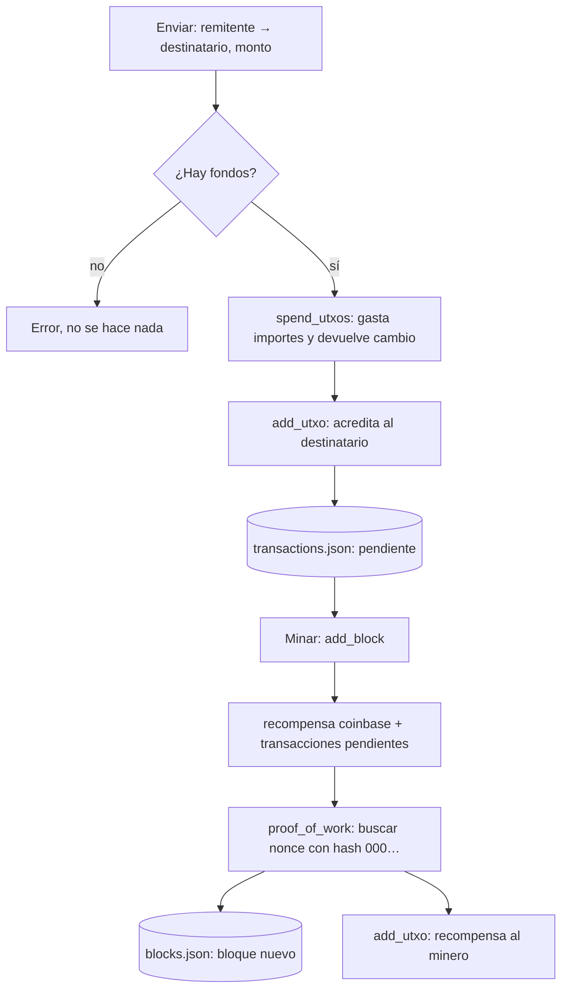

# Blockchain en Python

Una blockchain pequeña y completa, hecha desde cero para entender cómo funciona por dentro: **wallets** con claves de curva elíptica, **transacciones** con saldos al estilo UTXO, **minería** con prueba de trabajo (SHA‑256) y **validación** de la cadena. Se maneja desde una aplicación web hecha con Streamlit.

<picture>
  <source media="(prefers-color-scheme: dark)" srcset="docs/img/anatomia-oscuro.svg">
  
</picture>

> **La cadena como una máquina.** Cada caja es un bloque de `data/blocks.json`. Su hash es la llave; los tres primeros dientes a ras son el `000` de la prueba de trabajo. La cerradura de la caja siguiente guarda el `previous_hash`. Si no encajan, el acoplamiento se abre, que es exactamente lo que detecta `is_valid_chain()`.
> La imagen de arriba es el caso "alteré el bloque 1 y lo volví a minar, pero me olvidé del 2".
> **[`docs/anatomia-blockchain.html`](docs/anatomia-blockchain.html)** es la versión interactiva (ábrela en el navegador, no necesita internet): puedes alterar un bloque, re‑minarlo y minar uno nuevo con la transacción pendiente. Usa **SHA‑256 de verdad** con los datos reales del repo.

## Qué hace

| Sección de la app | Qué puedes hacer |
|---|---|
| **Inicio** | Ver cuántos bloques y transacciones hay y cuál es la recompensa de minería. |
| **Usuarios** | Crear una wallet (par de claves ECDSA `secp256k1`) y ver la dirección. |
| **Transacciones** | Enviar saldo de un usuario a otro. Queda pendiente hasta que alguien mine. |
| **Minería** | Elegir minero y minar un bloque con las transacciones pendientes. |
| **Blockchain** | Ver los bloques: índice, hash, hash anterior, nonce, nº de transacciones y fecha. |
| **Balances** | Ver el saldo de cada usuario. |

## Cómo ejecutarlo

Necesitas Python 3.9 o superior y, **por ahora, Windows** (ver [Limitaciones](#limitaciones-conocidas)).

```bash
pip install -r requirements.txt
streamlit run app.py
```

También hay un script de demostración sin interfaz, que usa los usuarios `Fonsi` y `Oliver` de `data/users.json`:

```bash
python main.py
```

## Estructura

```
app.py                  interfaz web (Streamlit)
main.py                 demo por consola
functions/
  blockchain.py         Block, Blockchain: hash, prueba de trabajo, validación
  transaction.py        TransactionManager: transacciones pendientes
  utxo.py               UTXOManager: saldos de cada usuario
  users.py              User: claves, dirección, firma
data/
  blocks.json           la cadena (el "libro mayor")
  transactions.json     transacciones pendientes de minar
  utxos.json            saldos de cada usuario
  users.json            wallets
docs/                   figura interactiva e imágenes de este README
```

## Cómo funciona

### Un bloque

```json
{
  "index": 1,
  "timestamp": "2025-06-06T17:10:00.176625",
  "transactions": [ ... ],
  "previous_hash": "000e56c8ed10…",
  "nonce": 453,
  "hash": "0000198c6ba8…"
}
```

El `hash` es el SHA‑256 de todo lo demás (`index`, `timestamp`, `transactions`, `previous_hash` y `nonce`) serializado como JSON con las claves ordenadas. Puedes comprobarlo tú mismo con un bloque real del repo:

```python
import json, hashlib

b = json.load(open("data/blocks.json"))[1]
texto = json.dumps({"index": b["index"], "timestamp": b["timestamp"],
                    "transactions": b["transactions"],
                    "previous_hash": b["previous_hash"], "nonce": b["nonce"]},
                   sort_keys=True).encode()
print(hashlib.sha256(texto).hexdigest() == b["hash"])   # True
```

Cambia un solo carácter (por ejemplo `50.0` por `51.0`) y el hash pasa de `0000198c6ba8…` a `8fb98e5deac5…`: no se parece en nada. Esa es la propiedad en la que se apoya todo lo demás.

### Prueba de trabajo (minería)

Un hash cualquiera no vale. Con `difficulty=3`, el hash del bloque tiene que **empezar por `000`**. Como no hay forma de predecir el hash, `Block.proof_of_work` prueba `nonce = 0, 1, 2, …` hasta que sale uno que cumpla. Cada dígito hexadecimal tiene 16 valores, así que hacen falta unos 16³ = 4096 intentos de media. En los datos del repo: el bloque 0 necesitó 968 intentos (nonce 967), el 1 necesitó 454 (nonce 453) y el 2 necesitó 910 (nonce 909).

Comprobar un bloque cuesta un hash; fabricarlo cuesta miles. Esa asimetría es la que hace que alterar el historial sea caro.

### La cadena

Cada bloque guarda el hash del anterior en `previous_hash`. Por eso, si alteras el bloque 1:

1. Su hash recalculado ya no coincide con el guardado → `Hash incorrecto en el bloque 1`.
2. Si lo vuelves a minar para que cuadre, su hash nuevo ya no es el que el bloque 2 tiene en `previous_hash` → `Hash anterior no coincide en el bloque 2`.
3. Para taparlo tienes que corregir y re‑minar el bloque 2, luego el 3, y así hasta el final.

`Blockchain.is_valid_chain()` recorre los bloques desde el 1 y comprueba, en este orden, que el hash recalculado coincide con el guardado, que empieza por `000` y que `previous_hash` es el hash del bloque anterior. Se detiene en el primer error. La figura interactiva reproduce ese recorrido con un cabezal lector.

### Bloque génesis y recompensa

- El bloque 0 se crea solo la primera vez, con una transacción `premine` de 1000 monedas para `Fonsi` y `previous_hash = "0"`.
- Al minar, `add_block` añade al principio del bloque una transacción `coinbase → minero` con la recompensa (3 monedas más las comisiones, que hoy siempre valen 0) y la suma a los saldos del minero.

### Wallets y saldos

- Cada usuario tiene un par de claves ECDSA sobre `secp256k1` (la misma curva que Bitcoin). Su **dirección** es el SHA‑256 de la clave pública.
- Los saldos están en `data/utxos.json`: para cada dirección, una lista de importes (`cantidad`). Al enviar, `spend_utxos` gasta los importes más grandes hasta cubrir la cantidad y devuelve el **cambio** como un importe nuevo. `consolidate_utxos` junta luego todos los importes de cada usuario en uno solo.

### Flujo de una transacción



Los saldos cambian en cuanto se envía la transacción; el bloque solo deja constancia de ella.

## Limitaciones conocidas

Es un proyecto de aprendizaje y se nota en estos puntos. Los he comprobado ejecutando el código:

- **El bloque génesis no se valida.** `is_valid_chain` empieza en `i = 1`: si alteras el bloque 0, devuelve `True`. Tampoco comprueba que las transacciones sean válidas (saldos, firmas), solo los hashes y los enlaces.
- **Las transacciones no se firman.** `User.sign_message` y `User.verify_signature` existen, pero `TransactionManager` no los usa: cualquiera puede enviar saldo en nombre de otro.
- **Los saldos no salen de la cadena.** `utxos.json` es un fichero aparte, y nada obliga a que coincida con `blocks.json`. Con los datos actuales, la cadena registra dos transferencias `Fonsi → Rafa` de 50 y `utxos.json` no tiene a Rafa.
- **No hay red ni consenso.** La cadena es un único fichero local: quien pueda editarlo puede re‑minar todo el historial. Con dificultad 3 son unos pocos miles de hashes, es decir, milisegundos.
- **Solo funciona en Windows.** Las rutas están escritas con barra invertida (`r'data\users.json'`); en Linux o macOS `os.makedirs('')` falla.
- **`data/users.json` guarda las claves privadas sin cifrar.** Son claves de prueba: no las reutilices en ningún otro sitio.
- **`main.py` no vacía `transactions.json` tras minar** (la app sí), así que ejecutarlo dos veces mina otra vez las mismas transacciones.

## Ideas para seguir

- Firmar cada transacción con la clave privada del remitente y verificarla antes de aceptarla.
- Calcular los saldos recorriendo la cadena en lugar de guardarlos aparte.
- Validar también el bloque génesis en `is_valid_chain`.
- Usar `os.path.join` para que funcione en cualquier sistema operativo.
- Un `.gitignore` con `venv/` y `__pycache__/`.
